# Exploratory Data Analysis

Group's Research Question: How strongly do early childhood family income and parental education levels predict adult earning potential and employment status?

All the code and outputs are in `eda.ipynb`. The plots are saved in the `outputs` folder and shown below.

## Step 1: Dataset basics

We have two main datasets and two secondary datasets.

- **PSID:** 2,362 people and 25 columns. There is also a linkage file with 21,511 rows and 116 columns.
- **NLSY97:** 8,984 people and 12 columns.
- **Opportunity Insights (secondary):** 100 rows, one for each parental income percentile. These are group averages, not people.
- **ELS (secondary):** two tables of group percentages, not individual people.

## Step 2: Missing values and anomalies

We checked every dataset for duplicates, missing values, and strange codes. The full table of counts and what we did is at the end of `eda.ipynb`.

- No duplicate rows in PSID, the PSID linkage file, or NLSY97.
- PSID: code 99 means unknown for education (102 household heads and 80 spouses), and 9,999,999 means unknown for wages (121 rows). We treated these as missing. One family income was negative and we kept it, because the codebook says that can happen.
- PSID employment status has a code 99 (47 rows). We did not find what it means, so we left it as is.
- NLSY97: missing answers are stored as negative numbers, like 2,396 for household income and 3,783 for wages. We changed them to missing values. Education code 95 (ungraded) was left out of the education comparisons, and 1,162 skipped wages were set to 0 because those people had no job income.
- ELS: 3 missing values in each file were really source notes, so we removed them.
- Opportunity Insights: no problems in the columns we used.

## Step 3: Distributions

Every important feature has a distribution plot.

**NLSY97**

- Median household income is $37,650, median adult wages are $40,000, parents' median education is 12 grades, and median weeks worked is 52.
- 82.5% of people with valid answers had job income in 2020.

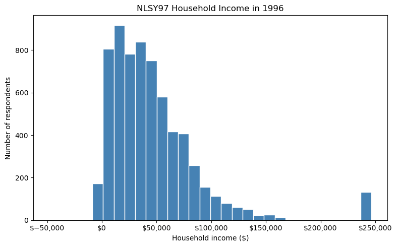

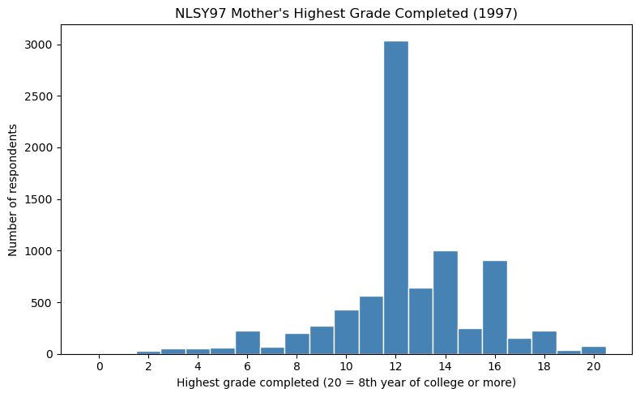

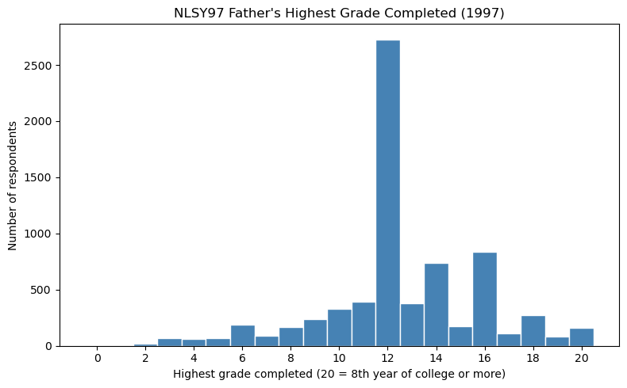

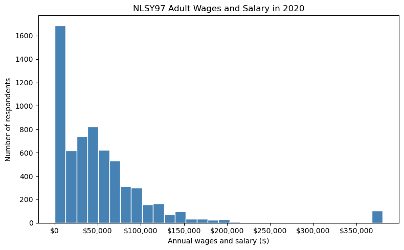

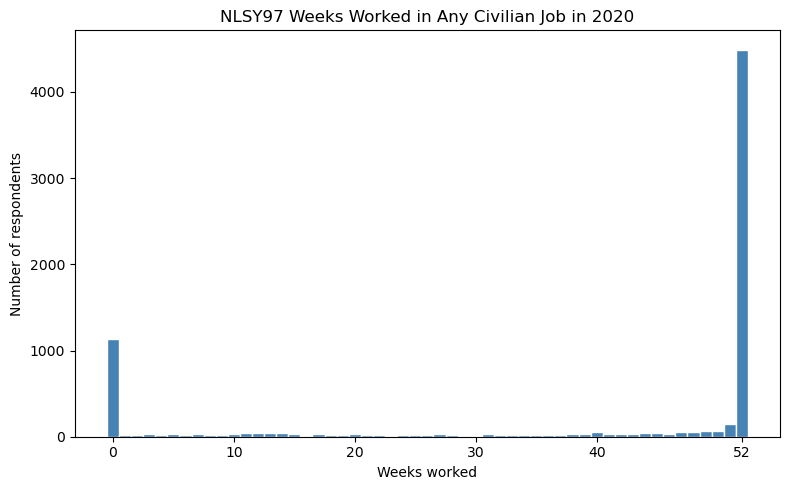

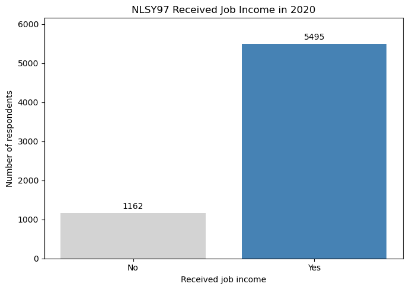

**PSID**

- Median family income is $29,539, and a few very high incomes stretch out the right side of the plot.
- Household heads' median education is 12 grades.
- Median adult wages are $8,000, and many people have 0.
- About 44% worked all 52 weeks and about 25% worked 0 weeks.

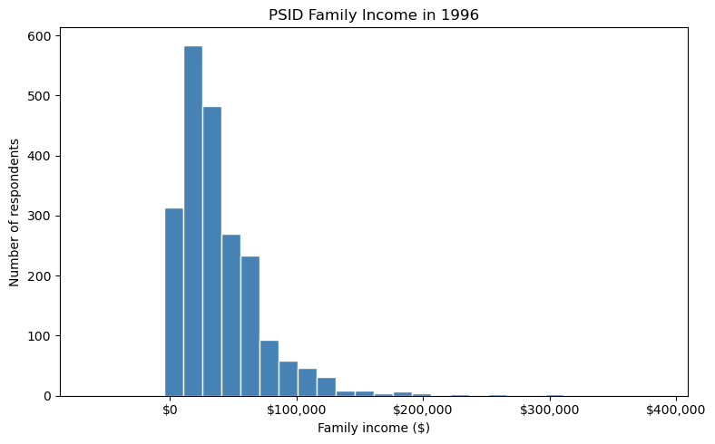

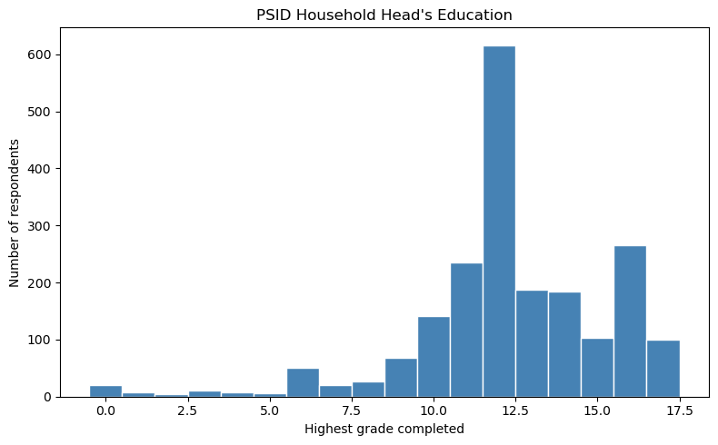

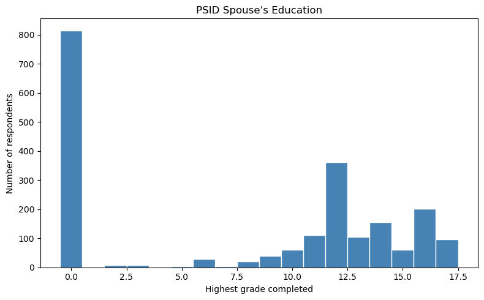

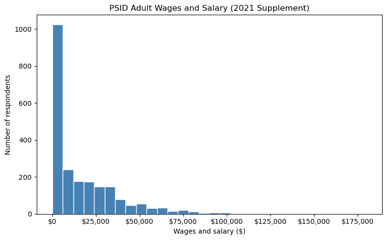

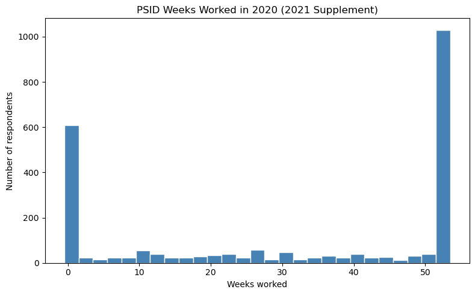

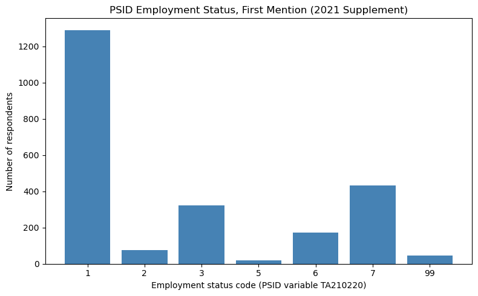

## Step 4: Relationships

These plots compare family background with adult outcomes. Each one has notes in the notebook on what it shows, whether we expected it, and what to explore next.

- **NLSY97:** parental education compared with adult wages.
- **PSID:** families with more-educated household heads tended to have higher income. We also plotted average adult wages by employment status.
- **Opportunity Insights:** average earnings at age 30 go up as parental income goes up, for both men and women. Men earn more on average.
- **ELS:** the low parental SES group had higher unemployment than the middle and high groups, even for people with postsecondary degrees.

These are patterns, not proof that family background causes the differences.

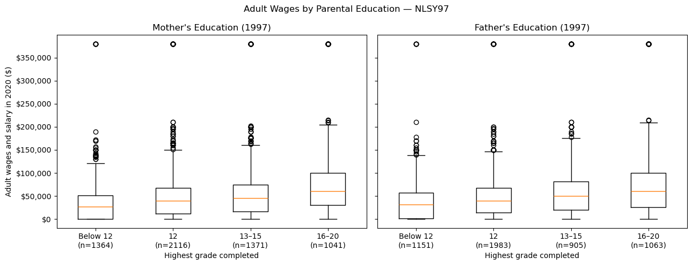

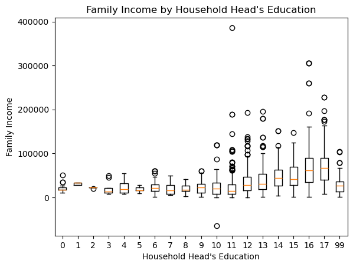

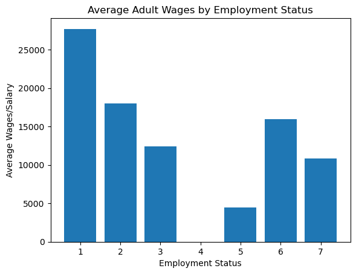

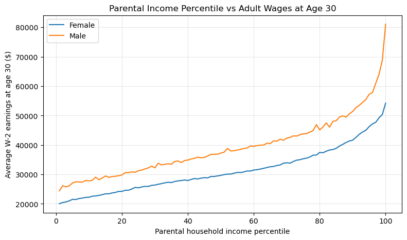

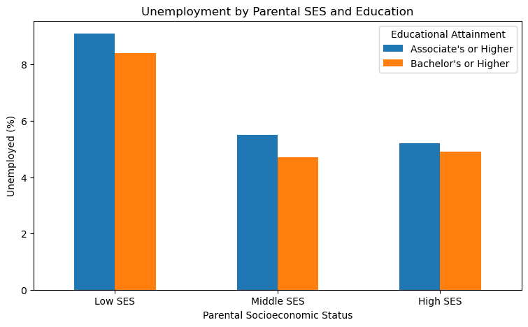

## Step 5: Secondary data comparison

This plot compares Opportunity Insights with NLSY97. The dollar amounts are not comparable, so each dataset is compared to its own average. In Opportunity Insights, earnings go from 0.63 times the average for the lowest parental income to 1.93 times for the highest. In NLSY97 they go from 0.65 to 1.83. The pattern is very similar. The datasets use different years, ages, and groups of people, so this only compares the shape and not the exact amounts.

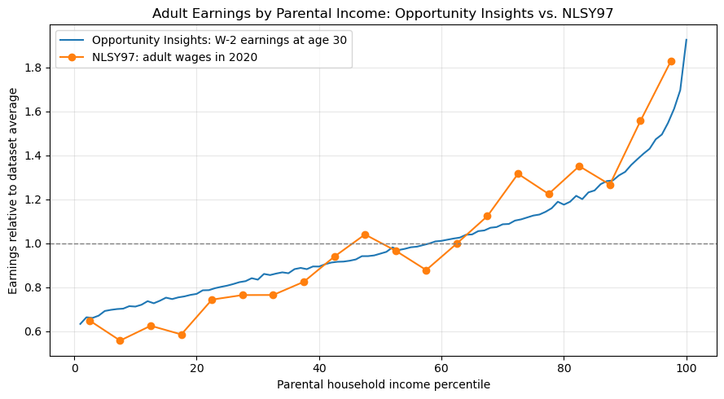

## Step 6: Research question

**Our research question:** How strongly do early childhood family income and parental education levels predict adult earning potential and employment status?

We are keeping the same question. Nothing in the exploratory analysis made us change it. What changed is how we plan to answer it:

- Our plots show that family income and parental education are associated with adult earnings and employment, but they do not show how strongly they predict them. That is for the modeling step.
- We will measure employment with weeks worked and whether someone had job income, because the PSID employment status codes are unclear and not the same across datasets.
- In PSID, parental education is the household head's and spouse's education, which is only an approximate measure.
- Opportunity Insights and ELS are group averages, so they support the main datasets and do not replace them.
