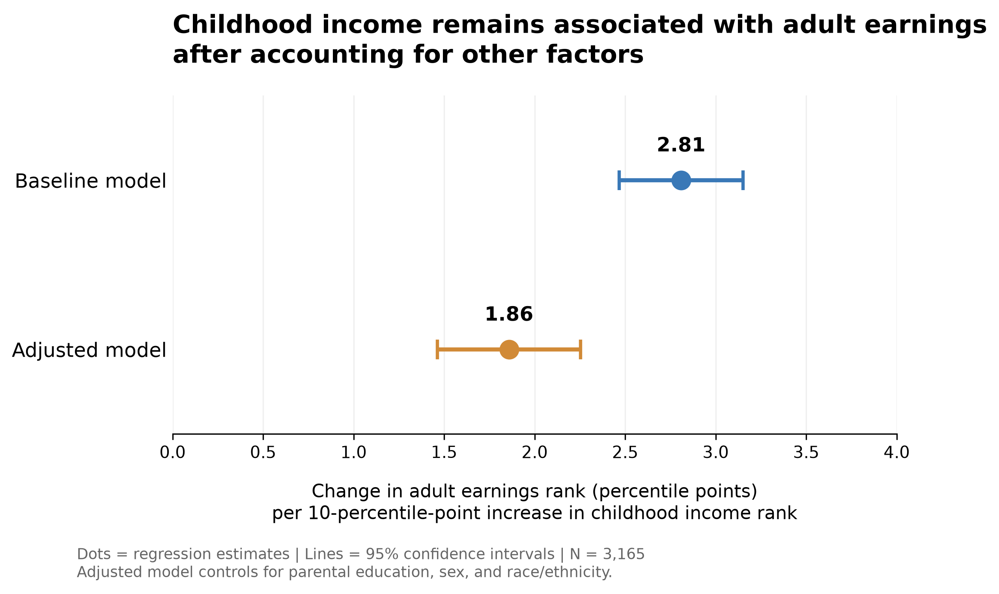
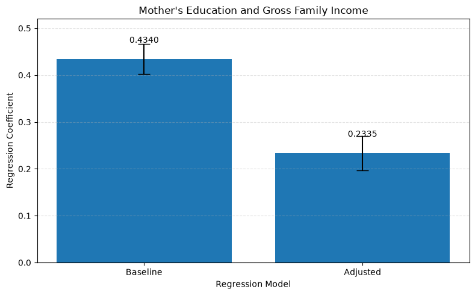
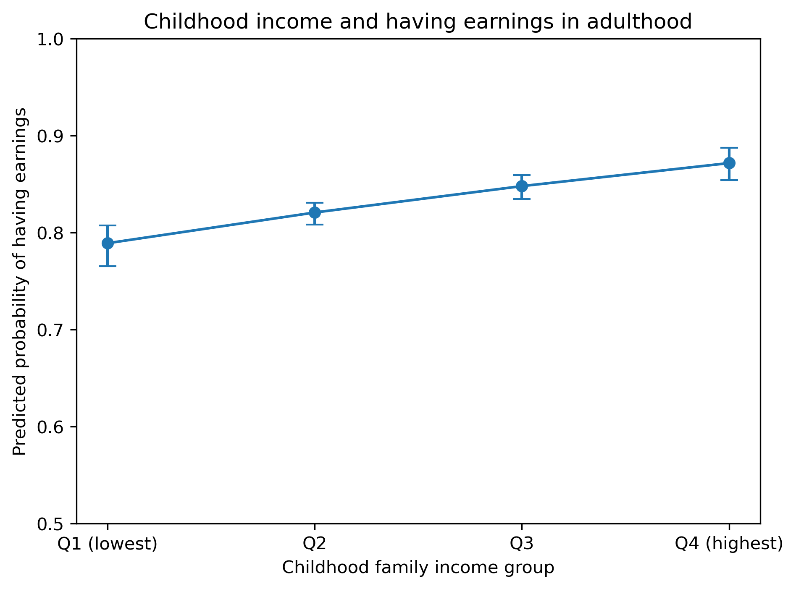

# cs418-family-background-outcomes

## Main Findings (Narrative Analysis)

- Among 3,847 NLSY97 respondents with valid childhood income and positive adult wages, a 10-percentile-point increase in childhood family income rank was associated with a 2.95-percentile-point increase in adult earnings rank (95% CI: 2.64–3.25), although childhood income rank explained only 8.7% of the variation in adult earnings rank.
- The simple linear regression analysis found a statistically significant positive relationship between gross family income rank and mother's education rank, with a regression coefficient of 0.4438 (p < 0.001). The R-squared value was 0.1886, indicating that gross family income rank explained approximately 18.86% of the variation in mother's education rank. The results suggest that higher family income rankings are associated with higher mother's education rankings. The sample consisted of 3,660 observations. However, this relationship does not establish causation.
- Among 4,747 NLSY97 respondents with valid childhood income, parental education, and a usable earnings answer, the predicted probability of having adult earnings rose from 78.9% in the lowest childhood family income quartile to 87.2% in the highest, after accounting for parental education, sex, and race/ethnicity (odds ratio per 10-percentile-point increase in income rank: 1.085; 95% CI: 1.050–1.120).
- [Person 4's finding]

### Finding 1
Using NLSY97 data, we looked at the relationship between childhood family income and adult earnings among 3,847 respondents with valid childhood income data and positive reported wages. Our linear regression showed that a 10-percentile-point increase in childhood family income rank was associated with a 2.95-percentile-point increase in adult earnings rank (95% CI: 2.64–3.25; p < 0.001). However, childhood income only explained about 8.7% of the variation in adult earnings rank, meaning there are likely other factors that play a role. One possible explanation is that parental education and demographic differences also influence this relationship. To check this, we ran another regression that accounted for parents' education levels, sex, and race/ethnicity. Using the same 3,165 respondents for both models, the income coefficient dropped from 0.2809 to 0.1858, a decrease of about 34%. Even after accounting for these other factors, the relationship was still positive and statistically significant (95% CI: 0.1462–0.2254; p < 0.001). Overall, our results suggest that childhood family income is related to adult earnings, but it is not the only factor associated with someone's earnings later in life. Since our data is observational, we also cannot conclude that higher childhood income directly causes higher adult earnings.

*Figure 1. The relationship between childhood family income and adult earnings becomes weaker after controlling for parental education, sex, and race/ethnicity, but remains positive. Points show regression estimates, and error bars show 95% confidence intervals.*

### Finding 2

My question was: Does a mother's education predict adult earnings after accounting for family income?
The baseline model examines the relationship between the mother's education and family income. The adjusted model accounts for father's education, sex, and race/ethnicity. The results for the baseline model included: Mother's education coefficent = 0.4340, R-squared = 18.23%, P-value = 2e-140. The results for the adjusted model included: Mother's education coefficent = 0.2335, R-squared = 29.99%, P-value = 1.537e-34. The coeffecient reduced by almost 50% but still remained statistically significant. This suggests that a mother's education is still positively associated with family income even after accounting for these other characteristics.

### Finding 3
We used NLSY97 data to ask whether a person's family background predicts whether they report any earnings as an adult. We counted respondents as having earnings if they said they had job income, and we left out the 2,327 who were not interviewed or did not answer, instead of counting them as having no earnings. Among 4,747 respondents, we ran a logistic regression using childhood family income rank, parents' education, sex, and race/ethnicity. Childhood income mattered: about 79% of respondents from the lowest-income quartile were predicted to have earnings, compared with about 87% from the highest (odds ratio per 10-percentile-point increase in income rank: 1.085; 95% CI: 1.050–1.120; p < 0.001). Parents' education also mattered. Respondents whose parents had less than a high school education had about half the odds of having earnings compared with those whose parents had college or more (OR 0.46; 95% CI: 0.35–0.61). The income result barely changed when we only counted people who reported a positive wage (OR 1.089; 95% CI: 1.054–1.125). One concern is that the 2,327 people we left out could differ from everyone else, but they were similar across income groups (24.1% missing in the lowest quartile and 26.2% in the highest), so this is unlikely to explain the pattern. Since the data is observational, these are associations and do not show that family background causes whether someone has earnings.

*Figure 3. Predicted probability of having adult earnings by childhood family income quartile, adjusting for parents' education, sex, and race/ethnicity. Dots are predicted probabilities and bars are 95% confidence intervals. The y-axis starts at 50%.*

### Finding 4
We compared the same rank–rank relationship in NLSY97, a survey of 8,984 young people, and Opportunity Insights, national tax-record data reported as means for each parental income percentile. In NLSY97 we ranked respondents by 1997 gross family income and by 2021 wages among the 3,847 with positive earnings, reproducing Finding 1's slope of 0.29 per percentile point. In Opportunity Insights we used the national parental household income percentile and the mean national individual income rank at age 30, averaged across women and men, and got a slope of 0.28 — inside NLSY97's 95% confidence interval. The quintile patterns match too: mean adult rank rises from about 37–39 in the bottom quintile to about 61–62 in the top in both datasets, a gap of 24.6 points in NLSY97 and 22.5 in Opportunity Insights. The pattern held in robustness checks — using household instead of individual rank at age 30 (0.33), individual rank at age 26 (0.26), and separately for women (0.25) and men (0.31) in Opportunity Insights, and for men (0.31) and women (0.27) in NLSY97. The datasets still differ: NLSY97 ranks are within its own sample of positive earners measured at about ages 37–41, while Opportunity Insights ranks are national, include zero earners, and measure earnings at age 30, and its narrow interval comes from fitting 100 group means rather than individuals, so its R² of 0.99 must not be compared with NLSY97's 0.09. Because both sources are observational, this replication strengthens the association without showing that parental income causes adult earnings.

Figure 4. The parental-income/adult-earnings relationship replicates across NLSY97 and Opportunity Insights. Panel A shows mean adult earnings rank by parental income quintile in each dataset; Panel B shows the rank–rank slope per 10-percentile-point increase in parental income rank, with 95% confidence intervals. The Opportunity Insights intervals come from fitting 100 percentile means, so they are narrower than the individual-level NLSY97 interval.
CS 418 Group Project: Asha, Mishal, Safiyyah, Saima

Group's Research Question: How strongly do early childhood family income and parental education levels predict adult earning potential and employment status?

Two Primary Datasets:
1) https://catalog.data.gov/dataset/the-panel-study-of-income-dynamics-psid?utm
2) NLSY97 (National Longitudinal Survey of Youth 1997) – NLSY97 1997-2023 (rounds 1-21), https://www.nlsinfo.org/content/cohorts/nlsy97?utm

Two Secondary Datasets:
1) https://opportunityinsights.org/data/?utm
2) https://nces.ed.gov/surveys/els2002/?utm

Notes about shape of data:
1. J365605.csv - (2362, 25)
2. M365605.csv - (21511, 116)

## Exploratory analysis

**Dataset basics:** PSID has 2,362 people and 25 columns (plus a linkage file with 21,511 rows). NLSY97 has 8,984 people and 12 columns. The secondary datasets are Opportunity Insights (100 parental income percentiles) and ELS (group percentages).

**Research question:** How strongly do early childhood family income and parental education levels predict adult earning potential and employment status? We kept the same question after the exploratory analysis. The plots show associations and not predictions, so the modeling step will test how strongly. We will measure employment with weeks worked and whether someone had job income, and in PSID parental education is the household head's and spouse's education.

**Anomaly notes:** Unknown codes (99 in PSID education, 9,999,999 in PSID wages, and negative codes in NLSY97) were treated as missing. NLSY97 education code 95 was left out of education comparisons, and 1,162 skipped NLSY97 wages were set to 0 for people with no job income. ELS source notes were removed. There were no duplicate rows. The full table is at the end of `eda.ipynb`.

**Major findings:**

- Adult earnings go up with family income in the Opportunity Insights and NLSY97 data, and the two follow a very similar pattern.
- In PSID, families with more-educated household heads tended to have higher income.
- In ELS, the low parental SES group had higher unemployment than the middle and high groups.
- These are patterns and do not show that family background causes the differences.

See `eda.ipynb` for the code and `EDA.md` for the full write-up.

## Data documentation

Full documentation is in [DATASHEET.md](DATASHEET.md). It covers each dataset's background, research scope, codebook, processing steps, access and reuse terms, and ethical considerations. 

| Dataset | Source | License / terms |
|---|---|---|
| PSID (primary) | [psidonline.isr.umich.edu](https://psidonline.isr.umich.edu/) | No open license. The [PSID Conditions of Use](https://simba.isr.umich.edu/U/CondUse.aspx) allow research and aggregate reporting only, require citation, and prohibit sharing extracts with others. PSID files here are treated as not redistributable. |
| NLSY97 (primary) | [bls.gov/nls/nlsy97.htm](https://www.bls.gov/nls/nlsy97.htm) | No named license found. BLS says its published material is [public domain](https://www.bls.gov/opub/copyright-information.htm) and asks for a BLS citation. |
| Opportunity Insights (secondary) | [opportunityinsights.org/data](https://opportunityinsights.org/data/) | No license found. Credit to Opportunity Insights is required when reusing its figures and charts. |
| ELS:2002 (secondary) | [nces.ed.gov/surveys/els2002](https://nces.ed.gov/surveys/els2002/) | No license statement on the tables. NCES releases data for statistical purposes only and prohibits identifying individuals. |

**Biggest data limitation:** A lot of respondents are missing key values (about a quarter of NLSY97 respondents have no adult earnings, and about half are dropped from the Opportunity Insights comparison), so results describe the people who answered, not everyone. The data also only shows associations, not causes.
